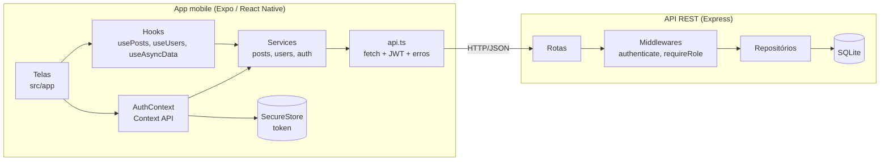
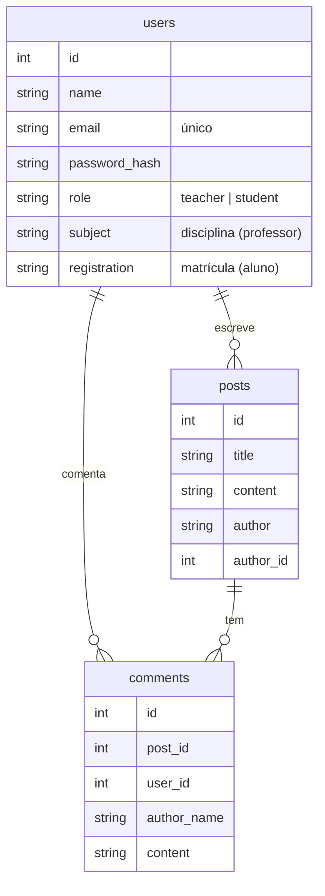

# EduBlog — Tech Challenge Fase 4 (Mobile)

Aplicativo mobile em **React Native (Expo)** para o blog educacional desenvolvido nas fases anteriores.
Professores publicam e administram conteúdos e cadastros; alunos leem os posts e comentam.

O repositório traz duas partes:

| Pasta | O que é |
|---|---|
| [`mobile/`](mobile) | App React Native (Expo SDK 58 + Expo Router + TypeScript) |
| [`backend/`](backend) | API REST em Node.js (Express 5 + SQLite + JWT) consumida pelo app |

---

## Sumário

1. [Funcionalidades x requisitos](#funcionalidades-x-requisitos)
2. [Tecnologias](#tecnologias)
3. [Setup inicial](#setup-inicial)
4. [Arquitetura da aplicação](#arquitetura-da-aplicação)
5. [Guia de uso](#guia-de-uso)
6. [API REST](#api-rest)
7. [Testes e qualidade](#testes-e-qualidade)
8. [Solução de problemas](#solução-de-problemas)

---

## Funcionalidades x requisitos

| # | Requisito do desafio | Onde está no app |
|---|---|---|
| 1 | **Página principal**: lista de posts com título, autor e breve descrição + busca por palavras-chave | Aba **Posts** — `src/app/(tabs)/index.tsx` (rolagem infinita, puxar para atualizar) |
| 2 | **Leitura de post** com conteúdo completo e comentários (opcional) | `src/app/posts/[id].tsx` + `features/posts/CommentsSection.tsx` |
| 3 | **Criação de posts** (título, conteúdo, autor + botão enviar) | `src/app/posts/create.tsx` → `features/posts/PostFormScreen.tsx` |
| 4 | **Edição de posts** carregando os dados atuais | `src/app/posts/edit/[id].tsx` (mesmo formulário, modo edição) |
| 5 | **Criação de professores** | `src/app/teachers/create.tsx` → `features/users/UserFormScreen.tsx` |
| 6 | **Edição de professores** | `src/app/teachers/edit/[id].tsx` |
| 7 | **Listagem paginada de professores** com botões Editar e Excluir | Aba **Professores** — `src/app/(tabs)/teachers.tsx` → `features/users/UserListScreen.tsx` |
| 8 | Requisitos 5, 6 e 7 **para alunos** | Aba **Alunos** + `src/app/students/create.tsx` e `students/edit/[id].tsx` (mesmos componentes, `role="student"`) |
| 9 | **Página administrativa**: todas as postagens com editar/excluir | Aba **Admin** — `src/app/(tabs)/admin.tsx` |
| 10 | **Login** e acesso restrito às páginas de criação/edição/administração | `src/app/login.tsx` + rotas protegidas em `src/app/_layout.tsx` e `src/app/(tabs)/_layout.tsx` |

Requisitos técnicos:

- **React Native com hooks e componentes funcionais** — todo o app; nenhum componente de classe.
- **Estilização** — identidade visual própria em `mobile/src/theme` (cores, espaçamentos, tipografia) usada por todos os componentes.
- **Integração com o back-end** — chamadas REST para posts, alunos, professores, comentários e autenticação em `mobile/src/services`.
- **Permissões** — professores criam/editam/excluem; alunos só visualizam (e comentam). Validado **no app** (rotas protegidas) **e na API** (middleware `requireRole`).
- **Gerenciamento de estado** — Context API (`AuthContext`) para a sessão + hooks próprios para os dados.
- **Documentação** — este README.

---

## Tecnologias

**Mobile** (`mobile/`)
- Expo SDK 58, React Native 0.88, React 19, TypeScript
- Expo Router (navegação por arquivos, `Stack.Protected` / `Tabs.Protected`)
- expo-secure-store (token JWT guardado no Keychain/Keystore)
- @expo/vector-icons (Ionicons)
- Jest + jest-expo + React Native Testing Library; ESLint (eslint-config-expo)

**Back-end** (`backend/`)
- Node.js 22.13+ (testado no Node 24), Express 5, TypeScript (tsx)
- SQLite nativo do Node (`node:sqlite`) — **não precisa instalar banco nem Docker**
- JWT (jsonwebtoken) + senhas com hash (bcryptjs)
- Validação com Zod
- Vitest + Supertest

---

## Setup inicial

### Pré-requisitos

- **Node.js 22.13 ou superior** (recomendado: 24 LTS) e npm
- Para rodar no celular: app **Expo Go** (compatível com o SDK 58), com o celular **na mesma rede Wi-Fi** do computador
- **iPhone:** uma conta Expo gratuita ([expo.dev/signup](https://expo.dev/signup)). No iPhone físico, o Expo Go só abre o projeto se o Expo CLI e o Expo Go estiverem logados na **mesma conta** (veja o passo 2). Android, emulador e navegador não precisam de conta.
- Opcional: emulador Android (Android Studio) ou simulador iOS (macOS/Xcode). O app também roda no **navegador**.

### 1. Subir a API (back-end)

```bash
cd backend
npm install
npm run dev
```

- A API sobe em `http://localhost:3333` e mostra no terminal os IPs da rede local (ex.: `http://192.168.0.10:3333`).
- Na primeira execução o banco (`backend/data/edublog.db`) é criado e **populado com dados de demonstração**: 7 professores, 12 alunos, 12 posts e alguns comentários.
- Configurações opcionais: copie `backend/.env.example` para `backend/.env` (porta, segredo do JWT, validade do token, caminho do banco).
- Para **zerar** o banco e recriar os dados de demonstração: `npm run seed`.

### 2. Rodar o app (mobile)

Em outro terminal:

```bash
cd mobile
npm install
npx expo start
```

- **Celular:** escaneie o QR code com o Expo Go (Android) ou com a câmera (iOS).
- **iPhone físico — antes de escanear:** rode `npx expo login` no computador (confira com `npx expo whoami`), abra o Expo Go no iPhone, toque no ícone de conta no canto superior direito e entre com a **mesma** conta. Depois reinicie o `npx expo start` e escaneie o QR code de novo.
- **Emulador Android:** pressione `a` no terminal do Expo.
- **Navegador:** pressione `w` (ou rode `npm run web`).

### 3. Endereço da API

O app descobre sozinho onde a API está (`mobile/src/services/config.ts`):

| Onde o app roda | Endereço usado |
|---|---|
| Expo Go no celular | IP do computador que roda o `npx expo start`, porta 3333 |
| Emulador Android | `http://10.0.2.2:3333` |
| Navegador / simulador iOS | `http://localhost:3333` |

Se a API estiver em outro lugar, crie `mobile/.env` a partir de `mobile/.env.example`:

```bash
EXPO_PUBLIC_API_URL=http://192.168.0.10:3333
```

e reinicie o `npx expo start`. A aba **Perfil/Entrar** do app mostra o endereço em uso.

### Contas de demonstração

| Perfil | E-mail | Senha |
|---|---|---|
| Professor(a) | `professor@edublog.com` | `prof123` |
| Aluno(a) | `aluno@edublog.com` | `aluno123` |

Os demais professores e alunos criados pelo seed usam a mesma senha do seu perfil (ex.: `carlos.lima@edublog.com` / `prof123`).
São dados fictícios, apenas para desenvolvimento — troque o `JWT_SECRET` e as senhas antes de qualquer uso real.

---

## Arquitetura da aplicação

### Visão geral



### Mobile (`mobile/`)

```
mobile/src
├── app/                      # Rotas (Expo Router): cada arquivo é uma tela
│   ├── _layout.tsx           # Stack raiz + AuthProvider + rotas protegidas
│   ├── (tabs)/               # Abas: Posts, Admin, Professores, Alunos, Perfil
│   │   ├── _layout.tsx       # Tabs (abas de professor só aparecem para professores)
│   │   ├── index.tsx         # Página principal (lista + busca)
│   │   ├── admin.tsx         # Página administrativa de posts
│   │   ├── teachers.tsx      # Listagem paginada de professores
│   │   ├── students.tsx      # Listagem paginada de alunos
│   │   └── account.tsx       # Perfil / entrar / sair
│   ├── login.tsx
│   ├── posts/[id].tsx        # Leitura do post + comentários
│   ├── posts/create.tsx      # Criação de post
│   ├── posts/edit/[id].tsx   # Edição de post
│   ├── teachers/create.tsx, teachers/edit/[id].tsx
│   └── students/create.tsx,  students/edit/[id].tsx
├── features/                 # Telas compartilhadas por várias rotas
│   ├── posts/                # PostFormScreen (criar/editar), CommentsSection
│   └── users/                # UserListScreen, UserFormScreen, roles.ts (professor x aluno)
├── components/               # UI reutilizável: Button, TextField, SearchBar, PostCard, UserCard, Pagination...
├── contexts/AuthContext.tsx  # Estado global de autenticação (Context API)
├── hooks/                    # usePosts, useUsers, useAsyncData, useDebounce, useRefreshOnFocus
├── services/                 # Comunicação com a API REST
│   ├── api.ts                # request(): fetch, token, timeout, erros amigáveis
│   ├── config.ts             # descoberta do endereço da API
│   ├── auth.service.ts, posts.service.ts, users.service.ts
│   └── token-storage.ts      # SecureStore (celular) / localStorage (web)
├── theme/                    # Cores, espaçamentos, tipografia, sombras
├── types/                    # Tipos compartilhados (User, Post, Comment, Paginated...)
└── utils/                    # Formatação, validação de formulários, alertas/confirmações
```

**Navegação e proteção de rotas.** O Expo Router usa a estrutura de pastas como mapa de navegação. Em `src/app/_layout.tsx`, as telas sensíveis ficam dentro de `<Stack.Protected guard={isTeacher}>` e as abas administrativas dentro de `<Tabs.Protected guard={isTeacher}>`. Quando a condição é falsa, a rota **não existe** para aquele usuário: um aluno ou visitante que tente abrir `/posts/create` ou `/admin` é redirecionado. A tela de login fica em `<Stack.Protected guard={!isAuthenticated}>` — ao entrar, ela some e o app volta para onde o usuário estava. O app só monta as rotas depois de restaurar a sessão salva, para não redirecionar antes de saber quem é o usuário.

**Estado (Context API).** `AuthContext` guarda o usuário logado e expõe `signIn`, `signOut`, `isTeacher` etc. Ao abrir o app, o token salvo é validado em `GET /auth/me`. Se a API responder `401` durante o uso (token expirado ou usuário excluído), o contexto encerra a sessão e avisa o usuário.

**Dados (hooks).** Cada tela usa hooks próprios:
- `usePosts(busca)` — paginação infinita, puxar para atualizar, busca com *debounce* e descarte de respostas antigas;
- `useUsers(papel, busca)` — paginação página a página para professores/alunos;
- `useAsyncData(fetcher)` — carregamento simples (post, comentários, formulários de edição);
- `useRefreshOnFocus` — recarrega a lista ao voltar de uma tela de edição.

**Camada de serviços.** As telas nunca chamam `fetch` diretamente: usam `postsService`, `usersService(role)` e `authService`, que passam por `request()` em `api.ts`. Ali ficam o token JWT no cabeçalho, o timeout, a conversão dos erros da API (inclusive erros por campo, exibidos embaixo de cada input) e a mensagem de "não foi possível conectar".

**Reuso professor/aluno.** Professores e alunos têm as mesmas telas: `UserListScreen` e `UserFormScreen` recebem `role` e leem textos, rotas e o campo extra (Disciplina ou Matrícula) de `features/users/roles.ts`.

**Acessibilidade.** Botões com `accessibilityRole`/`accessibilityLabel` descritivos (ex.: "Excluir Ana Souza"), áreas de toque de no mínimo 44 px, mensagens de erro anunciadas por leitores de tela (`accessibilityLiveRegion`), campos com rótulos visíveis e contraste adequado.

### Back-end (`backend/`)

```
backend/src
├── server.ts                 # Sobe o servidor (0.0.0.0) e cria os dados de demonstração na 1ª execução
├── app.ts                    # Monta o Express: CORS, JSON, rotas, erros
├── config.ts                 # Variáveis de ambiente (.env)
├── db/                       # Conexão SQLite, schema e seed
├── middlewares/              # authenticate (JWT), requireRole, tratamento de erros
├── modules/
│   ├── auth/                 # POST /auth/login, GET /auth/me
│   ├── posts/                # CRUD + busca de posts
│   ├── comments/             # Comentários de um post
│   └── users/                # CRUD de professores e alunos (mesmo router, papel diferente)
├── utils/                    # Paginação, busca por palavras-chave, JWT, erros HTTP
└── scripts/seed.ts           # npm run seed
```

**Modelo de dados**



**Segurança:** senhas com hash bcrypt; JWT com validade configurável; o usuário é recarregado do banco a cada requisição autenticada (conta excluída perde o acesso na hora); um professor não pode excluir a própria conta; respostas nunca incluem o hash da senha.

### Permissões

| Ação | Visitante | Aluno | Professor |
|---|:-:|:-:|:-:|
| Ver e buscar posts, ler comentários | ✅ | ✅ | ✅ |
| Comentar | — | ✅ | ✅ |
| Excluir comentário | — | só os seus | qualquer um |
| Criar, editar e excluir posts | — | — | ✅ |
| Página administrativa | — | — | ✅ |
| Listar, cadastrar, editar e excluir professores e alunos | — | — | ✅ |

---

## Guia de uso

### Visitante
1. Abra o app: a aba **Posts** lista os posts mais recentes. Role para carregar mais e puxe para baixo para atualizar.
2. Digite no campo **Buscar posts** — todas as palavras precisam aparecer no título, conteúdo ou autor.
3. Toque em um post para ler o conteúdo completo e os comentários.

### Aluno
1. Na aba **Entrar**, faça login (ex.: `aluno@edublog.com`).
2. Leia os posts e use o campo **Escreva um comentário** no fim de cada post. Você pode excluir os seus comentários.
3. A aba **Perfil** mostra seus dados, o que você pode fazer e o botão **Sair**.

### Professor
1. Faça login (ex.: `professor@edublog.com`). Aparecem as abas **Admin**, **Professores** e **Alunos**.
2. **Novo post:** botão **+** na aba Posts ou **Novo post** na aba Admin. Preencha título, autor (já vem com seu nome) e conteúdo e toque em **Publicar**.
3. **Editar/excluir post:** na aba **Admin** (ou dentro do post), use **Editar** — os dados atuais são carregados — e **Salvar alterações**; **Excluir** pede confirmação.
4. **Professores / Alunos:** listas paginadas (6 por página) com busca. **Novo** abre o cadastro; em cada linha, **Editar** abre a edição (deixe a senha em branco para mantê-la) e **Excluir** remove após confirmação.

---

## API REST

Base: `http://localhost:3333`. Todas as respostas são JSON. Rotas com 🔒 exigem o cabeçalho `Authorization: Bearer <token>`.

| Método | Rota | Acesso | Descrição |
|---|---|---|---|
| POST | `/auth/login` | público | `{ email, password }` → `{ token, user }` |
| GET | `/auth/me` | 🔒 qualquer | Usuário do token |
| GET | `/posts?q=&page=&limit=` | público | Lista paginada (mais recentes primeiro); `q` = palavras-chave |
| GET | `/posts/search?q=` | público | Atalho para a busca |
| GET | `/posts/:id` | público | Um post |
| POST | `/posts` | 🔒 professor | `{ title, content, author? }` (autor padrão = professor logado) |
| PUT | `/posts/:id` | 🔒 professor | Campos a alterar |
| DELETE | `/posts/:id` | 🔒 professor | Exclui o post e seus comentários |
| GET | `/posts/:id/comments` | público | Comentários do post |
| POST | `/posts/:id/comments` | 🔒 qualquer | `{ content }` |
| DELETE | `/posts/:id/comments/:commentId` | 🔒 autor ou professor | Exclui comentário |
| GET | `/teachers?q=&page=&limit=` | 🔒 professor | Lista paginada de professores |
| GET | `/teachers/:id` | 🔒 professor | Um professor |
| POST | `/teachers` | 🔒 professor | `{ name, email, password, subject? }` |
| PUT | `/teachers/:id` | 🔒 professor | Campos a alterar (`password` vazio mantém a atual) |
| DELETE | `/teachers/:id` | 🔒 professor | Exclui (não permite excluir a si mesmo) |
| GET/POST/PUT/DELETE | `/students...` | 🔒 professor | Igual a `/teachers`, com `registration` (matrícula) no lugar de `subject` |
| GET | `/health` | público | Verificação de saúde |

**Listas paginadas** respondem `{ data: [...], meta: { page, limit, total, totalPages } }` (`limit` máximo 50).

**Erros** respondem `{ message, errors? }` com o status adequado: `400` dados inválidos (com `errors` por campo), `401` sem login/sessão expirada, `403` sem permissão, `404` não encontrado, `409` e-mail já cadastrado.

---

## Testes e qualidade

```bash
# Back-end: 29 testes de integração (rotas, permissões, validação, paginação, busca)
cd backend
npm test
npm run typecheck

# Mobile: 27 testes (serviço de API, validação, formatação, componentes)
cd mobile
npm test
npm run typecheck
npm run lint
npx expo-doctor
```

---

## Solução de problemas

| Problema | O que fazer |
|---|---|
| App mostra "Não foi possível conectar à API" | Confira se `npm run dev` está rodando no `backend/`. No celular, o computador e o celular precisam estar na **mesma rede**. Veja na aba Perfil/Entrar qual endereço o app está usando e, se preciso, defina `EXPO_PUBLIC_API_URL` em `mobile/.env`. |
| Celular não acessa a API no Windows | Permita o Node.js no **Firewall do Windows** (redes privadas) ou libere a porta 3333. |
| iPhone: "You need to be signed in to Expo Go and Expo CLI to open your project" | Exigência do Expo Go no iPhone físico. Rode `npx expo login` no computador e entre no Expo Go (ícone de conta, canto superior direito) com a **mesma conta**; reinicie o `npx expo start` e toque em **Try Again**. Se a mensagem citar contas diferentes, saia de uma delas e entre com a outra. |
| Expo Go diz que o projeto é incompatível | Atualize o Expo Go — o projeto usa o **SDK 58**. |
| Porta 3333 em uso | Defina outra porta em `backend/.env` (`PORT=4000`) e use `EXPO_PUBLIC_API_URL` no app. |
| Quero voltar aos dados iniciais | `cd backend && npm run seed` |
